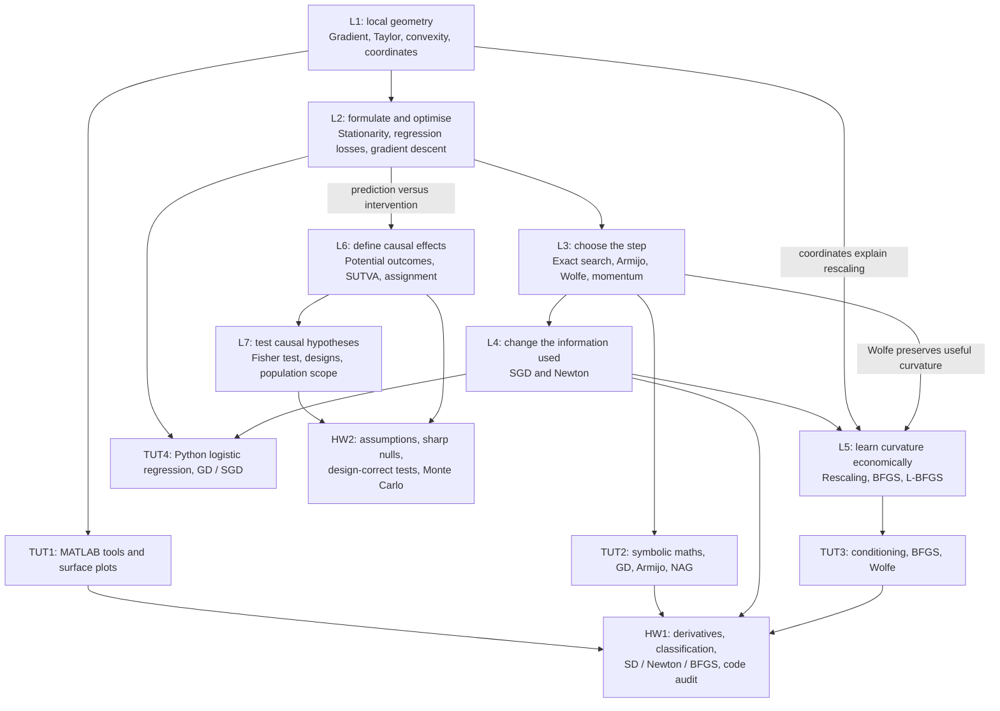

This course provides an in-depth exploration of a suite of analytical techniques, which are instrumental in modern business applications. The topics that are intended to be covered in this course are:
- **Nonlinear Optimization**: Dive deep into the nonlinear optimization techniques
that form the crux of machine learning algorithms.
- **Randomized Experiments**: Grasp the fundamentals of randomized experiments, the gold standard in causal inference.
- **Stochastic Models and Simulation**: Unveil the power of stochastic models and their ability to capture the randomness and unpredictability in business processes, aiding in more robust decision-making. Get familiar with simulation techniques, which are essential tools for risk assessment.
- **Dynamic Programming and Markovian Decision Processes**: Delve into the heart of reinforcement learning by understanding the intricacies of dynamic programming and Markovian decision processes. Discover their relevance in optimizing sequential decisions under uncertainty.

## Assessment:
- Class Participation and In-class quiz: 5%
- Homework Assignments: 45%
	- There will be 4 assignments. You can choose (but you are not obligated) to work in pairs (2 students form a pair) for each assignment. And you can form a different pair across these 4 assignments. If you and your teammate choose to form a pair on one assignment, then you two only need to submit ONE copy of the assignment with both of your names and student ID on the front page of the assignment. It is your and your teammate’s responsibility to make sure the submission is on time. You DO NOT need to inform us in advance about your team’s information. We will take note from the front page of your assignment submission.
- Final Exam: 50%
	- Close book with one A4 double-sided “cheat sheet” allowed. The exam will be on 30 NOV 2026, 9:00-11:00 (The information on this website shall prevail https://www.comp.nus.edu.sg/cug/soc-sched). Paper and Pen, Face to Face in a classroom 

![[Screenshot 2026-08-13 at 2.28.42 AM.png]]

## Review roadmap: Lectures 1–7

> [!info] Scope and how to use this
> Built from the original lecture slides, tutorial materials and homework questions in `/Users/kienanana/Documents/SCHOOL/Y4S1/BT3102`, reviewed 2 October 2026. No other vault BT3102 notes were read. **Lecture numbers below follow the actual L1–L7 files.** The syllabus's provisional weekly topic plan differs from these files; tutorial folder numbers also differ from their labelled weeks (TUT1 = Week 3, TUT2 = Week 4, TUT3 = Week 5, TUT4 = Week 6).
>
> Follow the diagram for the big picture, the lecture table for topics, and the practice sequence for what to attempt next. Exam checkpoints are revision targets inferred from the material and assignments, not confirmed exam questions. Only HW1–2 and TUT1–4 are currently available here.

### The flow of ideas

**Two main questions organise the material.** L1–5 ask: “How do we choose parameters that minimise a function, within a computation budget?” L6–7 ask: “How do we learn whether an intervention changes outcomes, and how much evidence do we have?” Logistic regression links the blocks by making the distinction between predicting an outcome and establishing a treatment's causal effect concrete.

### Topics by lecture, and what they unlock

| Lecture | Topics and connections within the lecture | What this lets you do |
| --- | --- | --- |
| **L1 — foundations** | **Slides 4–12:** partial derivatives → gradient → directional derivative → why the negative gradient is steepest descent and perpendicular to contours. **13–15:** convex sets/functions, smoothness, first/second-order Taylor approximations and Hessian. **16–26:** vectors, bases, linear transformations and coordinate changes. | Compute local slope/curvature; construct a Taylor model; interpret plots. Prepares HW1 **P1(a–c)** and TUT1's matrix/plotting work. Coordinate changes return in L5/TUT3. |
| **L2 — optimisation and model fitting** | **1–3:** positive definite/semidefinite matrices. **4–11:** constrained/unconstrained problems, necessary stationarity, local/global extrema, saddle points; least-squares regression and its closed form. **12–16:** logistic model → likelihood → log-likelihood → iterative minimisation. **17–25:** descent direction, GD update, learning rate, initialisation, stopping and computational cost. **26:** line search versus trust region. | Formulate a loss, derive a gradient and run basic GD. Classify stationary candidates for HW1 **P1(d)** using Hessian tests; explain why stationarity alone is insufficient in **P2(c)**. Supplies the model/loss in TUT4. |
| **L3 — step selection and history** | **3–11:** exact line search, one-dimensional minimisation along a direction, quadratic example and zigzagging. **12–20:** bad step sizes → inexact search → Armijo sufficient decrease → Wolfe curvature test. **21–26:** momentum, exponentially weighted gradient history, Nesterov look-ahead and random restarts. | Implement TUT2's GD/Armijo/NAG; do HW1 **P2(a)**. Learn Wolfe now for HW1 **P3** and L5's BFGS. Explain what a step-size test checks and why momentum differs from restarting. |
| **L4 — noisy gradients and curvature** | **7–15:** sum/average losses → expensive full gradient → single-sample/mini-batch SGD, noise, runtime tradeoffs and stopping. **16–27:** second-order information → Newton root finding → Newton optimisation, local quadratic convergence, Hessian cost and failure away from a minimum. **28–30:** quasi-Newton motivation and rescaling. | Do HW1 **P2(b–c)** and compare Newton with SD; recognise a non-descent Newton step. Complete TUT4's GD/SGD comparison. Sets up why L5 approximates curvature. |
| **L5 — rescaling and quasi-Newton methods** | **5–11:** ill-conditioning → coordinate transformation → SD is not invariant to rescaling → Newton as locally rescaled SD. **12–18:** learn curvature from steps/gradient changes, symmetry, secant equation, small updates, inverse-Hessian BFGS and Wolfe. **19–21:** implicit updates, two-loop recursion and limited history in L-BFGS. **22–23:** common iterative framework and norm interpretation. | Complete TUT3; implement HW1 **P3**, audit **P4**, and attempt bonus **P5**. Compare iteration count, runtime and storage separately. Connect L1's matrices and L3's Wolfe tests to a practical algorithm. |
| **L6 — causal effects and identification** | **2–21:** prediction/correlation versus causation, confounding, controls/placebos and problems with before/after comparisons. **22–30:** potential outcomes, observed outcome, individual effects, missing counterfactuals and SUTVA. **31–41:** population average effect → observed difference in means → assignment mechanism → independence from potential outcomes. | Attempt HW2 **P1(a–b)**. Read the experiment in **P2(a)** and identify units, treatment, outcome and target population. Understand the quantities that L7's test uses. |
| **L7 — randomization inference and design** | **6–18:** sharp null → impute missing outcomes → statistic → assignment distribution → tail probability. **19–28:** Bernoulli, complete, stratified/block and paired assignment; each changes the allowed assignment vectors. **29–35:** experiment population versus super-population, sampling versus assignment, selection bias and treatment effect on the treated. | Complete HW2 **P1(c–d)** and **P2(b–h)**. Construct a distribution under the stated null **and actual design**; interpret a p-value and limit generalisation to the population supported by sampling. |

### When to attempt tutorials and homework

This is a **recommended review order based on prerequisites**, rather than the original class timetable. Break homework into parts as soon as the relevant ideas are available.

| Stop after… | Attempt before moving on | Readiness checkpoint |
| --- | --- | --- |
| **L1** | **TUT1 / Week 3:** MATLAB vectors/matrices, indexing, element-wise versus matrix operations, linear solves, functions, loops and plots; Ackley surface/grid example. Start HW1 **P1(a–c)**. | Derive a gradient and Hessian; write a second-order Taylor approximation at a given point; explain why it is local. |
| **L2** | Finish HW1 **P1(d)**. Use **TUT2's symbolic calculation material** and fixed-rate GD sections. Optionally preview TUT4 **§3.1–3.2** for logistic loss and full-batch GD. | Distinguish stationary point, local minimum and global minimum; explain when convexity supplies a global guarantee. |
| **L3** | Finish **TUT2 / Week 4**, including Armijo and NAG. Do HW1 **P2(a)**. Practise one exact-search calculation and one Armijo/Wolfe acceptance check on paper. | Separate the search direction from the step size; explain why mere decrease is weaker than sufficient decrease. |
| **L4** | Do HW1 **P2(b–c)**, then compare with P2(a). Attempt **TUT4 / Week 6 §2–3.3**: NumPy, logistic GD, full/mini/single-sample SGD. | Explain why Newton may reach a saddle/maximum or fail, and why cheaper SGD iterations can outweigh slower iteration convergence. |
| **L5** | Do **TUT3 / Week 5**: ill-conditioning, transformation, SD/Armijo, BFGS/Armijo and BFGS/Wolfe. Then HW1 **P3(a–b)** → **P4(a–b)** → optional **P5**. Finish TUT4 **§3.4**, linking manual fitting to library fitting. | Explain how gradient differences reveal curvature, why Wolfe matters to BFGS, and why a plausible final result does not validate an update formula. |
| **L6** | Do HW2 **P1(a–b)**; inspect **P2(a)** and write down its causal setup. Practise observed versus potential outcomes and finite-population average effects. | Spot interference even when nobody shares the tool; identify time/practice effects in a before/after study. |
| **L7** | Do HW2 **P1(c–d)**, then **P2(b–d)** → **P2(e–f)** → **P2(g–h)**. | First construct an exact test; then compare designs, audit the simulation, compare nulls and approximate the same valid test by Monte Carlo. |

**TUT4 is the programming bridge into HW2.** Its NumPy indexing, group means and plotting transfer, but its supplied statistical application is logistic regression, not Fisher testing. There is no separate randomized-experiment tutorial in the available TUT1–4 files.

### Homework question map

| Question | Core skill | Lecture dependencies |
| --- | --- | --- |
| **HW1 P1(a–b)** | Himmelblau gradient/Hessian and four-valley surface plot | L1 + TUT1 plotting/symbolic tools in TUT2 |
| **HW1 P1(c)** | Second-order Taylor model at (1,1); assess its local accuracy | L1 |
| **HW1 P1(d)** | Solve for stationary points, classify by curvature, justify local/global status | L1–2; second-order test is also explicitly prompted by HW1 |
| **HW1 P2(a)** | SD with Armijo backtracking | L2–3 + TUT2 |
| **HW1 P2(b–c)** | Full-step Newton; compare starts, objective values, iterations and stopping | L1–4 |
| **HW1 P3(a–b)** | Dixon–Price SD versus BFGS with Wolfe; convergence plots, runtime and dimension | L3 + L5 + TUT3 |
| **HW1 P4(a–b)** | Audit BFGS's curvature denominator; distinguish correct formula from successful output | L5 |
| **HW1 P5 — bonus** | L-BFGS, memory size and high-dimensional storage/convergence | L5 |
| **HW2 P1(a–b)** | SUTVA/interference; limits of using the same person as their own control | L6 |
| **HW2 P1(c)** | Sharp zero-effect null versus zero average effect | L6–7 |
| **HW2 P1(d)** | Paired versus complete assignment spaces | L7 |
| **HW2 P2(a–b)** | Caffeine study setup; impute outcomes under the constant-effect sharp null of +2 | L6–7 + TUT4 Python skills |
| **HW2 P2(c–d)** | Exact complete-randomization distribution, summaries, observed statistic, upper-tail p-value and decision | L7 |
| **HW2 P2(e)** | Conditional nonempty Bernoulli design; compare with the actual fixed-size design | L7 |
| **HW2 P2(f)** | Audit label shuffling under a nonzero sharp null | L6–7 |
| **HW2 P2(g)** | Rebuild for the zero-effect sharp null; interpret rejection/non-rejection | L7 |
| **HW2 P2(h)** | Monte Carlo approximation of the actual complete-randomization test | L7 + notebook-specific simulation instructions |
### Exam practice checkpoints
Use small hand calculations after each practice block. The supplied syllabus describes a paper-and-pen exam; these checkpoints translate the coding tasks into reasoning skills without predicting the exam's scope.

| Skill to practise | A useful check | Source to revisit if stuck |
| --- | --- | --- |
| Derivation and classification | Compute gradient/Hessian and Taylor model; classify a stationary point and state what remains inconclusive | HW1 P1; L1–2 |
| Iteration mechanics | Carry out one GD, momentum or Newton update; test a proposed step with Armijo/Wolfe | TUT2; HW1 P2; L3–4 |
| Algorithm choice | Compare SD, SGD, Newton, BFGS and L-BFGS using information needed, cost, storage and convergence assumptions | L4–5; HW1 P3/P5; TUT4 |
| Formula/code audit | Check BFGS's secant/curvature logic rather than trusting its final objective value | HW1 P4; L5 |
| Causal setup | Identify unit, treatment, outcome, potential outcomes, estimand, assignment and SUTVA concerns | L6; HW2 P1(a–b) |
| Randomization test | On a tiny example, impute under a sharp null, enumerate legal assignments, compute statistics and count the specified tail including ties | L7; HW2 P2(b–d) |
| Design and interpretation | Count allowed assignments; distinguish sharp versus average null, assignment versus sampling, and non-rejection versus proof | HW2 P1(c–d), P2(e–g); L7 |
| Simulation audit | Explain what randomness is simulated and why a fixed seed does not remove Monte Carlo error | HW2 P2(f,h) |
**Two recurring traps:** “global convergence” in the optimisation slides refers to convergence towards stationarity from general starting points under assumptions; it is not a promise of a global minimum. In causal testing, failure to reject a constant-effect sharp null does not prove that every individual has that exact effect.

## Lecture study notes

The annotated PDFs are the source of record; the lecture notes retain essential definitions, formulas, concepts, assumptions and connections between lectures. Original PDFs remain in the school folder; the vault holds byte-for-byte copies with annotations preserved. Copies do not automatically synchronise with later edits to the originals.

- [[L1 Course Introduction|Lecture 1 — Calculus and linear algebra foundations]] · [[Lecture1_2026.pdf|Annotated PDF]]
- [[L2 Optimisation and Gradient Descent|Lecture 2 — Optimisation and gradient descent]] · [[Lecture2_2026.pdf|Annotated PDF]]
- [[L3 Line Search and Momentum|Lecture 3 — Line search and momentum]] · [[Lecture3_2026.pdf|Annotated PDF]]
- [[L4 Stochastic Gradient Descent and Newton Methods|Lecture 4 — Stochastic gradient descent and Newton methods]] · [[Lecture4_2026_extended.pdf|Lecture PDF]]
- [[L5 Rescaling and Quasi-Newton Methods|Lecture 5 — Rescaling, BFGS and L-BFGS]] · [[Lecture5_2026.pdf|Lecture PDF]]
- [[L6 Potential Outcomes and Causal Effects|Lecture 6 — Potential outcomes and causal effects]] · [[Lecture6_2026_extended.pdf|Lecture PDF]]
- [[L7 Randomization Tests and Experimental Design|Lecture 7 — Randomization tests and experimental design]] · [[Lecture7_2026_extended.pdf|Lecture PDF]]
- [[L8 Markov Chains and PageRank|Lecture 8 — Markov Chains and PageRank]] · [[Lecture8_2026_extend.pdf|Lecture PDF]]
- [[L9 Random Variable Generation and MCMC|Lecture 9 — Random Variable Generation and MCMC]] · [[Lecture9_2026_extend.pdf|Lecture PDF]]
- [[L10 Markov Decision Processes and Value Iteration|Lecture 10 — Markov Decision Processes and Value Iteration]] · [[Lecture10_2026_extended.pdf|Lecture PDF]]

Use the PDF page links for full derivations, examples, diagrams and handwriting. Each lecture note ends with connections to other lectures; use the review roadmap above for tutorial and homework sequencing.

### Lectures 8–10: essential sequence

Built from the individual L8, L9 and L10 lecture PDFs on 28 October 2026. The review roadmap above retains its original L1–7 scope.

| Lecture | Must know | Readiness checkpoint |
| --- | --- | --- |
| [[L8 Markov Chains and PageRank|L8 — Markov chains and PageRank]] | Markov property; column-stochastic transitions; PageRank repairs; stationary versus limiting versus occupation distributions; HMM emissions | Propagate a distribution, solve for stationarity and explain why periodicity can prevent convergence |
| [[L9 Random Variable Generation and MCMC|L9 — Random-variable generation and MCMC]] | Generalised inverse CDF; exponential/discrete sampling; rejection sampling and valid envelopes; Metropolis acceptance and repeated states | Generate from a specified CDF, check a rejection sampler and explain how MCMC uses stationarity |
| [[L10 Markov Decision Processes and Value Iteration|L10 — MDPs and value iteration]] | States/actions/transitions/rewards; discounted return; stationary policies; Bellman equations; value iteration | Carry out one Bellman backup, extract a greedy action and account for terminal rewards once |

**Connection:** L8 models random state transitions; L9 generates the randomness and uses chains to sample target distributions; L10 adds choices and rewards to optimise sequential decisions.
